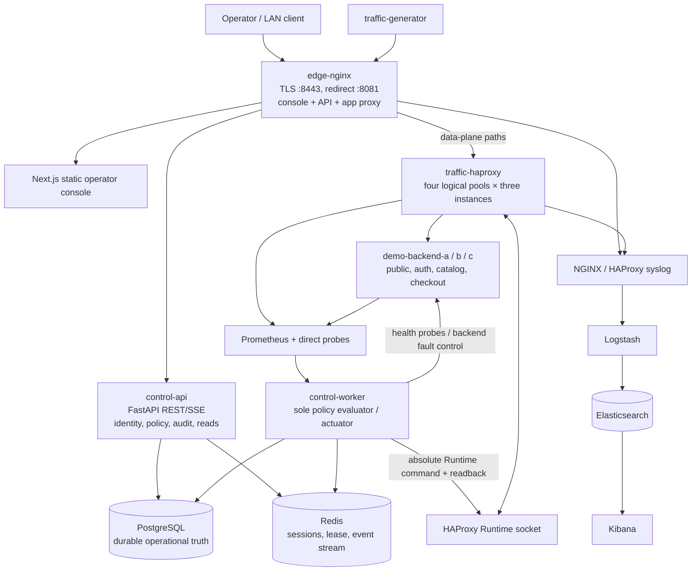
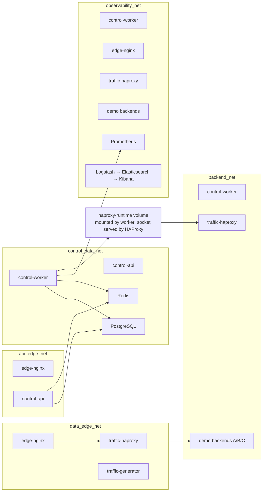

# Self-Healing Load Balancer — architecture overview

## Purpose

This is a local-network prototype for Evidence-Bounded Minimum-Scope Healing. It detects a supported failure shape, gathers evidence about its scope, applies a narrow HAProxy runtime change, verifies both the failing route and preserved routes, and reintegrates traffic through staged recovery.

The system deliberately separates request traffic from control/actuation and observation. NGINX is the only host-published edge. The API has no HAProxy authority; a single worker owns the HAProxy Runtime socket.

## Logical architecture

## Container and authority boundaries

| Component | Responsibility | Network/access boundary |
| --- | --- | --- |
| `edge-nginx` | TLS termination, static console delivery, reverse proxy for API and application traffic, access logs | Sole published service: host ports 8081 and 8443; joins edge/API/observability networks |
| `traffic-haproxy` | Routes the four application pools to predeclared backend instances; exposes private stats/runtime interfaces | Private networks; no host-published port |
| `control-api` | Authentication, scoped REST reads/writes, CSRF/origin/idempotency handling, audit/outbox, SSE | API edge + control data networks; no backend or HAProxy runtime access |
| `control-worker` | Evidence evaluation, rule classification, desired-state writes, HAProxy actuation/readback, verification, recovery | Control data + backend + observability networks; sole mount of HAProxy Runtime socket |
| `postgres` | Durable incidents, action state, audit, policies, desired state and outbox | Control data network only |
| `redis` | Sessions, bounded writer lease, event stream and SSE cursors | Control data network only |
| `prometheus` | Bounded metrics source used by the worker for evidence | Observability network; not published |
| `logstash`, `elasticsearch`, `kibana` | Internal forensic log pipeline and search UI | Observability network; not published |
| `traffic-generator` | Bounded synthetic traffic for real request evidence | Data edge network |
| `demo-backend-a/b/c` | Deterministic application routes and protected local fault endpoints | Backend + observability networks; fault surface is private |

## Network segmentation

The repeated nodes show a service attached to more than one isolated Docker network. Network membership is the reachability boundary: the API cannot reach the backend or Runtime socket; the worker can reach the private evidence and actuation surfaces but does not publish a host port. Only NGINX bridges API and data-plane edge networks.

## Failure diagnosis and healing flow

1. Synthetic requests, backend metrics, direct probes, and HAProxy readback provide independent observations.
2. The worker evaluates route-by-instance evidence and classifies supported states such as `HEALTHY`, `INSTANCE_DOWN`, `ROUTE_INSTANCE_FAILURE`, `SHARED_ROUTE_FAILURE`, or `UNKNOWN`.
3. The worker persists an incident, evidence certificate, exact candidate target, preservation set, rollback plan, and prepared desired state in PostgreSQL before actuation.
4. The sole writer sends an absolute HAProxy Runtime command through the mounted socket and reads state back.
5. Verification checks that the targeted symptom improves, unaffected routes remain healthy, and observed state matches the requested state. Ambiguous results enter review rather than being blindly retried.
6. After fault clearance, staged reintegration moves through probe and gradually increasing traffic weights, with sample/probe/readback gates at each step.
7. The API exposes operational state through authenticated REST and an authorized SSE stream. PostgreSQL outbox events are published through Redis.

## Data flow and APIs

- Browser UI uses same-origin relative `/api/...` calls through NGINX.
- API includes system status/capabilities, environment matrix and summaries, incident/decision trace, action attempts, reintegration, and LAB fault endpoints.
- Writes use scoped RBAC, CSRF, allowed-Origin checks, idempotency keys, and structured audit/outbox records.
- SSE uses Redis-backed cursors; an expired cursor signals the frontend to refetch current authorized state.
- PostgreSQL is authoritative durable state. Redis is coordination/session/event infrastructure, not the source of incident truth.
- Runtime route objects are predeclared; the worker changes membership state, not HAProxy topology.

## Security and operational design

- Only NGINX publishes `0.0.0.0:8081` and `0.0.0.0:8443`; the latter serves TLS. Other service ports remain internal.
- Bootstrap secrets are generated into ignored local files. The local researcher password is stored at `.secrets/bootstrap_password`.
- The TLS certificate is self-signed and intended for local lab use.
- Compose services use bounded resources, read-only filesystems where supported, restricted tmpfs mounts, no-new-privileges, bounded log rotation, and short Prometheus retention.
- The worker uses both a PostgreSQL advisory lock and a bounded Redis lease to prevent competing writers.
- The repo explicitly describes traffic-overload control, multi-node HA, production autoscaling, LLM assistance, and several other capabilities as unsupported or planned. Treat this as a research/demo prototype.

## Source map

- [README.md](README.md): lifecycle, user workflow, supported behavior, limits, API list.
- [docker-compose.yml](docker-compose.yml): service definitions, ports, networks, volumes, secrets.
- [control-api/README.md](control-api/README.md): API process role and data-access boundary.
- [frontend/](frontend/): Next.js operator console.
- [control-api/](control-api/): API, worker, migrations, domain logic.
- [haproxy/](haproxy/), [nginx/](nginx/), [observability/](observability/): edge, routing and telemetry configuration.
